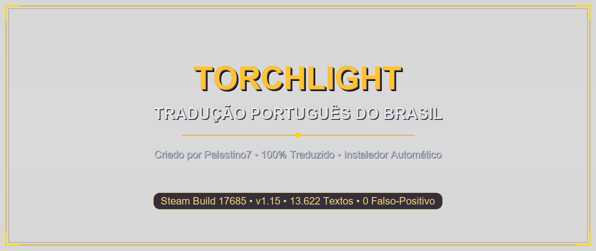
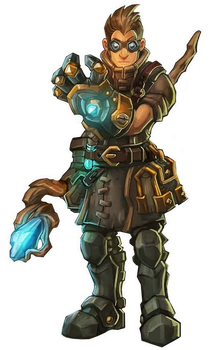

# Torchlight — Tradução em Português do Brasil (pt-BR)

[-orange.svg?style=for-the-badge)](https://store.steampowered.com/app/41500/Torchlight/)

**Tradução completa, canônica e profissional de *Torchlight* para Português do Brasil.**  
Criado e mantido por **[Palestino7](https://github.com/palestino7)**.

 

[⬇️ **BAIXAR INSTALADOR (.EXE)**](https://github.com/palestino7/Torchlight-ptBR/releases/download/v1.2.0/Torchlight_Traducao_ptBR_Setup.exe) &nbsp;&bull;&nbsp; [📦 **BAIXAR PACOTE (.ZIP)**](https://github.com/palestino7/Torchlight-ptBR/releases/download/v1.2.0/Torchlight_Traducao_ptBR_v1.2.0.zip)

 

---

## 🎮 Classes Totalmente Traduzidas

Toda a história, missões, itens, falas e árvores de habilidades das 3 classes estão 100% em português:

| **Destruidor** | **Alquimista** | **Vingadora** |
| :---: | :---: | :---: |
|  |  |  |
| Especialista em combate corpo a corpo e poder ancestral | Mestre em magia elemental de Âmbar e golens | Atiradora de elite com armas de fogo, arcos e armadilhas |

---

## 🚀 Como Instalar (3 Passos Rápidos)

1. **Passo 1:** Baixe o arquivo [Torchlight_Traducao_ptBR_Setup.exe](https://github.com/palestino7/Torchlight-ptBR/releases/download/v1.2.0/Torchlight_Traducao_ptBR_Setup.exe).
2. **Passo 2:** Feche o jogo e execute o instalador baixado.  
   *(Ele encontra automaticamente a pasta do jogo na Steam: `C:\Program Files (x86)\Steam\steamapps\common\Torchlight`)*.
3. **Passo 3:** Clique em **Avançar** $\rightarrow$ **Instalar** e abra o jogo diretamente pela Steam!

---

## 🛡️ Aviso do Windows SmartScreen

Por ser um instalador comunitário novo e gratuito (sem certificado comercial pago da Microsoft), o Windows Defender SmartScreen pode exibir uma janela azul dizendo *"O Windows protegeu o seu computador"*:

1. Clique em **"Mais informações"**.
2. Clique no botão **"Executar assim mesmo"**.

> O instalador é **100% seguro e limpo (0/72 detecções no VirusTotal)**, compilado nativamente sem empacotadores suspeitos (zero UPX). Seus jogos salvos ficam intactos e nunca são alterados.

---

## 🔐 Hashes Oficiais (SHA-256 Checksum)

Se desejar conferir a autenticidade dos arquivos da [Release Oficial](https://github.com/palestino7/Torchlight-ptBR/releases/tag/v1.2.0):

| Arquivo de Distribuição | Tamanho | Hash SHA-256 Oficial |
| :--- | :--- | :--- |
| `Torchlight_Traducao_ptBR_Setup.exe` | 2.3 MB | `1d90e42de4d661abe603b9d4de96dada164e26f53e3a64bb3bf2726e889cbe92` |
| `Torchlight_Traducao_ptBR_v1.2.0.zip` | 1.8 MB | `71b3221b324bc3549e5da4751202586635f20eac9b9b49fb91696f6bae0da697` |

---

## 👤 Créditos

- **Idealização, Tradução e Instalador**: **[Palestino7](https://github.com/palestino7)**
- **Jogo Original**: Runic Games Inc. (Torchlight © 2009)
